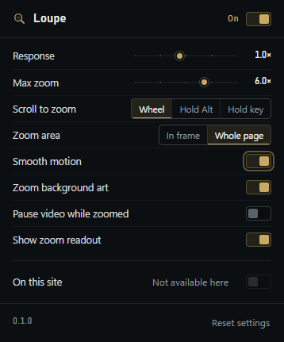

# Loupe

**Hover any photo, video or artwork, scroll, and it zooms in right at your cursor. Hold left-click to pan.**

A Manifest V3 extension for Chromium browsers. It turns the pictures and videos already on the page into something you can inspect up close — no right-click, no new tab, no upload, no account.



---

## What it does

| You do | Loupe does |
| --- | --- |
| Scroll up over a photo or video | Zooms in, centred on the exact pixel under the pointer |
| Keep scrolling while moving the mouse | Keeps zooming and re-centres on wherever the pointer is now |
| Scroll down | Zooms back out; at 1.0× the next scroll scrolls the page again |
| Hold left-click and move | Pans the zoomed image 1:1 with the pointer |
| `Esc` or double-click | Ends the zoom immediately |
| `Alt+Shift+Z` | Turns Loupe on or off everywhere |

**What counts as media:** ``, `<video>` (including MediaSource streamers such as Instagram Reels, YouTube and X), `<canvas>`, and CSS `background-image` art when that option is on. Everything is gated by size — at least 120×120 on screen — so icons, avatars and card chrome stay out of the way.

**Two zoom modes.** *Whole page* (default) lets the zoom grow past the picture's own frame and paints it above the page, so fixed headers, like/comment rails and modals never cover it. *In frame* clips the zoom to the picture's box, like a loupe resting on the page, leaving the surrounding layout untouched.

**Settings** live in the toolbar panel: response, max zoom, scroll-to-zoom trigger (plain wheel, hold Alt, or hold any key/mouse button you pick), zoom area, smooth motion, pause-video-while-zoomed, background art, and the on-screen readout pill.

## Who it is for

Anyone who reads a lot of visual detail on the web — photographers checking focus, designers reading type in a screenshot, artists studying linework, buyers inspecting a product photo, or anyone squinting at a small diagram. If the first thing you do on a big image is open it in a new tab and pinch-zoom, this removes that step.

## Install (load unpacked)

Loupe is **not** in an extension store yet, so you install it by pointing the browser at the folder. Full walkthrough with screenshots: [docs/INSTALL.md](docs/INSTALL.md).

1. **Download** [`loupe.zip`](https://github.com/34rns/loupe/releases/latest/download/loupe.zip) and extract it somewhere permanent — the browser links to that exact path.
2. Open your extensions page: `chrome://extensions`, `brave://extensions`, `edge://extensions` or `opera://extensions`.
3. Turn on **Developer mode** (top-right).
4. Click **Load unpacked** and select the extracted `loupe` folder — the one that contains `manifest.json`, not its parent.
5. Pin Loupe from the puzzle-piece menu, then refresh any tabs that were already open.

Then point at a picture and scroll up. A dark readout pill (`2.4×`, `esc`) appears next to your cursor.

Chromium only: **Chrome, Brave, Edge, Opera, Vivaldi.** Firefox is not supported by this build.

## Updating

Unpacked extensions **cannot auto-update**. To move to a new version:

1. Download the new [`loupe.zip`](https://github.com/34rns/loupe/releases/latest/download/loupe.zip) and replace the old folder's contents.
2. Open the extensions page and click the **reload** arrow on the Loupe card.
3. Refresh the page you are testing.

That link always points at the newest release, so it never changes. The **Chrome Web Store** is the option for automatic updates later — see [docs/releasing.md](docs/releasing.md).

## Documentation

- [docs/INSTALL.md](docs/INSTALL.md) — install, per-browser notes, uninstall, troubleshooting
- [docs/USE.md](docs/USE.md) — every gesture, setting and edge case
- [docs/releasing.md](docs/releasing.md) — how to cut a release

## Development

Plain JavaScript, no bundler, no build step.

```bash
npm install
npm run test:unit   # zoom maths and the settings contract
npm run test:e2e    # drives a real Chromium with the extension loaded
```

The first `test:e2e` run downloads its own copy of Chromium; it does not touch your everyday browser.

```
manifest.json      MV3 manifest
content/           zoom engine, target detection, HUD, bridge
popup/             toolbar panel (settings)
shared/            settings contract shared by popup and content script
icons/             16 / 32 / 48 / 128
docs/              install + usage guides
test/              unit and Playwright e2e suites
tools/             icon and design-audit helpers
```

## Privacy

Loupe makes **no network requests**. There is no analytics, no telemetry, no crash reporting, no update check and no remote assets. Its only permission is `storage`, which is how it remembers its own settings. Every image it zooms is one the page already loaded.

## License

[MIT](LICENSE) © 34rns
