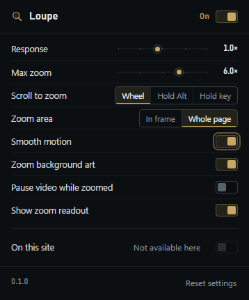
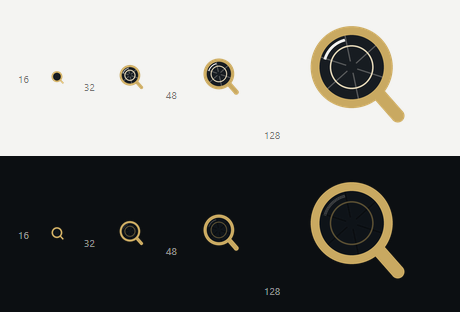

# Using Loupe

Loupe turns any large picture or video on a web page into something you can inspect up close: point at it, scroll up, and the spot under your pointer grows.

**About this build:** it is **Brave/Chromium only** (Brave, Chrome, Edge, Opera, Vivaldi), it is **unpacked** — it runs from the `loupe` folder on disk, not from a store — and it needs **no store install**. It also needs the browser's **Developer mode** to stay on, because that is what allows an unpacked extension to run. If you have not installed it yet, do that first: [INSTALL.md](INSTALL.md).

---

## The gestures

Put the pointer over the picture or video, not over the caption or the surrounding page.

| You do | Loupe does |
| --- | --- |
| **Scroll up** over the media | Zooms in, centred on the exact pixel under the pointer |
| **Keep scrolling** while moving the mouse | Keeps zooming, and re-centres on wherever the pointer is now |
| **Scroll down** | Zooms back out |
| **Scroll down to 1.0×** | Ends the zoom; the very next scroll scrolls the page again |
| **Hold the left mouse button and move** | Pans the zoomed image 1:1 with the pointer (only works while zoomed in) |
| **Press Esc** | Ends the zoom immediately |
| **Double-click** | Ends the zoom immediately; the page does not receive the double-click |
| **Move the pointer off the picture** | Eases the image back to normal (instantly, if **Smooth motion** is off). When the zoom fills the window there is nowhere left to move off it: use Esc, a double-click, or scroll back to 1.0× |
| **Press Alt+Shift+Z** | Turns Loupe on or off everywhere. There is no on-page confirmation — open the toolbar panel and read the state next to the switch |

Two details worth knowing:

- **A drag is not a click.** If you move the pointer more than about three pixels while holding the button, Loupe swallows the click that would normally follow the mouse-up, so dragging a photo never opens the post. A plain click with no movement still reaches the page, so tapping a photo still opens it as it normally would.
- **The zoom does not "stick" to the page scroll.** While you are zoomed, Loupe takes the scroll wheel; at 1.0× it hands it straight back, so you can scroll past the image without a dead zone.

### Holding a key of your own

Scrolling does not have to zoom on its own. **Scroll to zoom** in the panel has three choices, and the third is yours: set it to **Hold key**, then click the chip that appears and press any key **or mouse button**. From then on, scrolling zooms only while that input is down — hold **G** and scroll, or hold the **middle mouse button** and scroll. The default is **Shift**.

The held input is watched, not swallowed: typing a letter that happens to be your hold key still reaches the page, and nothing is blocked when you are not scrolling. Press Esc while the chip is waiting to cancel the change.

### In frame, or across the page

**Zoom area** in the toolbar panel decides how far the magnification is allowed to reach:

- **Whole page** (default) — the picture grows past its own frame and can cover the rest of the window. Best when you want to inspect a big photo at full size. The zoom is painted above the page itself, so nothing the site draws can cover it: fixed headers, sticky bars, like/comment rails, badges, modals and later-loaded cards all stay underneath. Nothing on the page is rearranged either, so a carousel never leaks — the slides either side of the one you zoom stay out of sight until you leave the zoom.
- **In frame** — the zoom is clipped to the picture's own box, like a loupe resting on the page. Nothing around the picture moves or gets covered, so a post's like/comment bar, a gallery's thumbnails, the site header and the layout itself all stay exactly where they were, and only the picture's own rectangle changes.

Your gestures are identical in both modes, and so is the readout pill. **Whole page** is the default and the one to trust on unfamiliar sites; **In frame** is the calm choice when you want the page around the picture to stay exactly as it is.

### What counts as media

- `` pictures
- `<video>` players, including streaming players that feed the element through MediaSource (Instagram Reels, YouTube, X and most modern video sites). A live video keeps playing in the zoom, unless **Pause video while zoomed** is switched on in the panel, which freezes it for the duration and resumes it when you leave)
- `<canvas>` drawings
- Elements that paint a CSS `background-image`, when **Zoom background art** is on

Everything is gated by size. Pictures, videos and canvases must be **at least 120 × 120 pixels** on screen; background art must be at least **200 × 120**. That is deliberate: icons, avatars, tiny thumbnails and card chrome stay out of the way, so scrolling over them behaves normally.

### The readout pill

While you are zoomed, a small dark panel follows your cursor:

- a number like **2.4×** — the current magnification
- the keycap **esc** — the fastest way out

It never takes a click or a scroll; clicks pass straight through it to the page. Turn it off with **Show zoom readout** in the panel.

---

## The toolbar panel

Click the brass lens icon on the toolbar. Everything in the panel saves the moment you change it and applies to open tabs immediately — no reload needed. The settings are remembered between browser restarts, because the browser stores them itself rather than keeping them in the page.

| Control | What it does |
| --- | --- |
| **Switch in the header**, with **On** / **Off** beside it | Master switch. Off means Loupe does nothing anywhere and the page scrolls normally |
| **Response** (0.25×–2.0×, default 1.0×) | How much one scroll notch zooms. Lower is finer and slower; higher is faster. This changes the zoom rate itself, so open a picture on a page and feel the difference |
| **Max zoom** (1.5×–8.0×, default 6.0×) | The ceiling. Scrolling past it stops doing anything |
| **Scroll to zoom**: **Wheel** / **Hold Alt** / **Hold key** | **Wheel** (default): plain scrolling over media zooms. **Hold Alt**: press and hold Alt *before* you scroll and keep holding it while scrolling; without Alt the page scrolls as usual. **Hold key**: the same, but with an input you choose — see *Holding a key of your own* above. Use either hold mode if a site feels like it fights you, then switch back to **Wheel** when you want plain scrolling to zoom again |
| **Held input** (only with **Hold key**) | The chip shows what must be held down, e.g. `Shift`, `G` or `Middle mouse`. Click it, then press the key or mouse button you want; **Esc** cancels. The choice is remembered |
| **Zoom area**: **In frame** / **Whole page** | Where the magnification may paint. **Whole page** (default): the picture grows past its frame and can cover the window, painted above every page element so no header, badge or card can cover it; a carousel's neighbouring slides stay hidden. **In frame**: the zoom is clipped to the picture's own box, so nothing around it moves or is covered |
| **Smooth motion** | On: the zoom eases over a fraction of a second. Off: it jumps straight to each step, which feels more mechanical but is easier to land on an exact level |
| **Zoom background art** | Also zoom elements whose picture comes from a CSS background (many hero banners and product tiles). Off: only pictures, videos and canvases zoom |
| **Pause video while zoomed** | **Off** (default): zooming never touches playback — the video keeps running while you inspect it. **On**: the video freezes for as long as you are zoomed, both on the page and in the zoomed copy, and plays on again the moment you leave the zoom (Esc, double-click, scroll back to 1.0×, or move the pointer off). Flip it mid-zoom and it takes effect immediately. A video the page had already paused is never started by this |
| **Show zoom readout** | The floating scale pill during zoom, described above |
| **On this site** | Shows the domain of the tab you are looking at, e.g. `instagram.com`. Switch it **off** to make Loupe ignore that domain entirely; switch the same control back **on** to restore it. The choice is remembered for that domain. On browser pages (settings, new tab, the Web Store) the row reads **Not available here** and the switch is greyed out, because browsers forbid every extension from running there — there is nothing to fix and nothing to enable |
| **Reset settings** | Puts every control back to its default — including the per-site exceptions, which means all sites start zooming again |
| **v0.1.0** in the footer | The version you are running |

---

## When it does not work

Check these four things first, in order. They explain most reports:

1. Is the pointer over the picture itself, in its middle, rather than over a caption or a button drawn on top of it?
2. Does the panel's header say **On**, and is **On this site** switched on?
3. Is **Scroll to zoom** set to **Wheel** (not **Hold Alt**)?
4. Was the tab open before you installed Loupe? If so, refresh it.

If all four are fine, find your symptom below.

| Symptom | Likely cause | Fix |
| --- | --- | --- |
| Loupe is not in the toolbar | It is installed but not pinned | Puzzle-piece icon near the address bar → pin **Loupe** |
| Loupe is not in the Extensions list at all | Developer mode is off, or the wrong folder was loaded | `brave://extensions` → Developer mode on. The folder must be the one containing `manifest.json`, not its parent) |
| The card appeared but pages do nothing | The tab was open before installing | Refresh the tab (`Ctrl+R`) |
| Scrolling does nothing on a picture | The picture is smaller than 120 × 120 px, or the pointer is over a caption or an overlay rather than the image | Point at the middle of the image itself, use a larger photo |
| Scrolling does nothing, the page scrolls | The master switch is off; the site is switched off; or **Scroll to zoom** is set to **Hold Alt** / **Hold key** and that input is not down | Check the panel: header state, **On this site**, and the **Scroll to zoom** choice — then hold the input the **Held input** chip names |
| The whole page gets bigger instead of one picture | You are using the browser's own zoom (`Ctrl` + scroll) | Release `Ctrl`; Loupe only reacts to a plain scroll |
| It works on one site but not another | The site is in the per-site exceptions, or the picture sits inside an embedded frame (an iframe) from another site, which Loupe cannot reach | Open the panel on that site; if **On this site** is off, switch it on |
| A site scrolls while you are trying to zoom | A few pages grab scrolling before anything else on the page can | Switch **Scroll to zoom** to **Hold Alt** (or **Hold key** with an input of your own), or switch **On this site** off (and back on later when you want Loupe there again) |
| A picture zooms but you would rather it stayed inside its own frame | **Whole page** is deliberately an overlay that covers the page | Switch **Zoom area** to **In frame**: the magnification is clipped to the picture, so the page around it never changes |
| Nothing changed after an edit to the folder | The browser still runs the old copy | `brave://extensions` → circular reload arrow on the Loupe card → refresh the tab |
| A PDF will not zoom | The built-in PDF viewer is a browser page, not a web page | Not supported in this build |
| A tab keeps scrolling when you expected zoom on a site you have not touched | Some pages take the scroll before Loupe sees it, or the media is inside an embedded frame | Try **Hold Alt** or **Hold key**, then switch **On this site** off if it is still in the way |
| A video zooms inside its own frame even though **Whole page** is selected | The player is copy-protected (DRM: Netflix, Prime Video, Disney+), so its frames cannot be reproduced above the page. Loupe falls back to **In frame** for that video instead of showing a black box | Nothing to fix — this is the working behaviour. **In frame** still magnifies the real player |
| A video keeps moving while you are trying to inspect one frame | **Pause video while zoomed** is off, which is the default | Turn it on in the panel; the video freezes while you are zoomed and plays again as soon as you leave the zoom |
| The video stays frozen after the zoom ended | The page itself paused it (autoplay rules, an in-page pause), or you paused it while zoomed | Press play on the player. Loupe only restarts a video that *it* paused |

If the card shows a red **Errors** button, click it and keep the text; that is a real bug and the message is what makes it fixable.

---

## Known limits

- **Mouse and trackpad scrolling only.** There is no pinch-to-zoom on touch screens.
- **Image quality has a ceiling.** If a page serves a small thumbnail, zooming past its real resolution looks soft. Loupe zooms the picture the page gave it.
- **Some media is out of reach.** A few sites build pictures in a way that hides them from every extension, and pictures embedded inside another site's frame (an iframe) usually cannot be zoomed either.
- **Browser pages are excluded.** Settings pages, the new-tab page and the extension store cannot be touched by any extension.
- **Brave/Chromium only.** There is no Firefox or Safari build. An up-to-date Brave, Chrome or Edge is all that is required (the manifest asks for Chromium 114 or newer).
- **Video player shortcuts stay the player's.** On sites that map the wheel to volume or seeking, Loupe takes the wheel only while you are zoomed there.
- **A held mouse button is watched, not captured.** In **Hold key** mode you can choose the middle or right mouse button; Loupe only reads whether it is down, so the page keeps whatever that button normally does once you release it.
- **A page-wide zoom is a copy, not the original.** To put the picture above the page, Loupe draws a stand-in of it in the browser's top layer and makes the page's own copy transparent for the duration. A photo or drawing is reproduced exactly; a live video is carried over as its live frames (a plain file shows its current frame if it cannot be streamed); a CSS background panel is reproduced with its own content. What you cannot do while zoomed is interact with that copy — clicks and scrolls still go to the page underneath. **In frame** moves the page's own element instead, if that matters.
- **If the copy cannot paint, the zoom moves into the page instead.** Some sources cannot be re-requested: a streaming player's single-use `blob:` URL, a hotlink-protected video, an image whose temporary URL has already been revoked, or copy-protected (DRM) video. Rather than hide the media behind an empty stand-in — which is what a black screen is — Loupe switches that session to **In frame**, so the real element is magnified where it sits. This happens on any site, not just the big ones.
- **Embedded pictures stay embedded.** A picture that lives in another site's frame (an iframe) can be zoomed, but only inside that frame: the zoom cannot paint over the page that hosts the frame.

---

## Updating to your own logo

The four toolbar images (`icons\icon16.png`, `icon32.png`, `icon48.png`, `icon128.png`) are currently drawn by a small script, `tools\make_icons.py`. You do not prepare or resize anything by hand: hand over the logo file (a PNG with a transparent background at 512 px or larger, or an SVG) and whoever maintains the folder (in this case, me) turns it into those four sizes and drops them into `icons\`. Nothing else in the extension changes.

To pick the new artwork up: `brave://extensions` → circular reload arrow on the Loupe card → refresh any open tab. If the toolbar still shows the old mark, unpin and re-pin the icon, or restart the browser.
